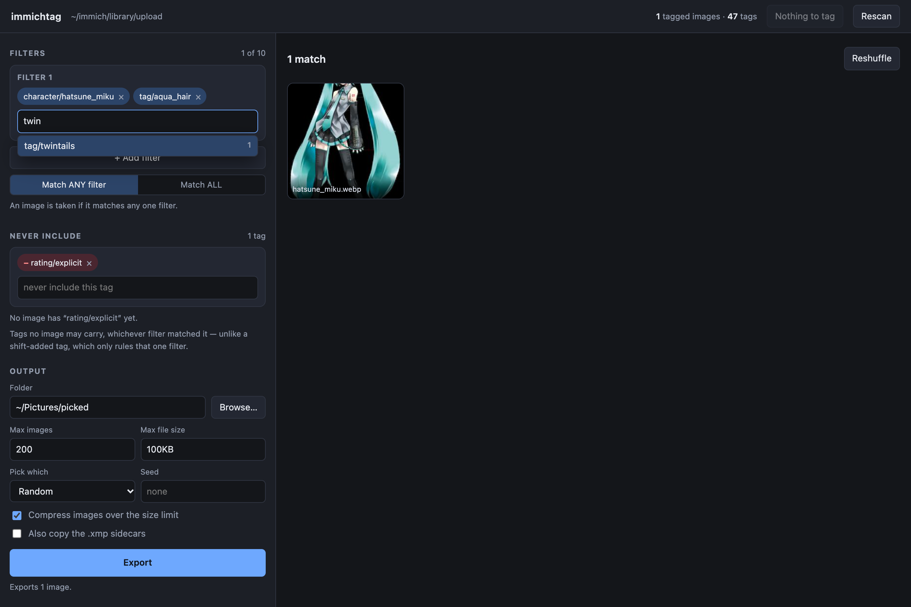
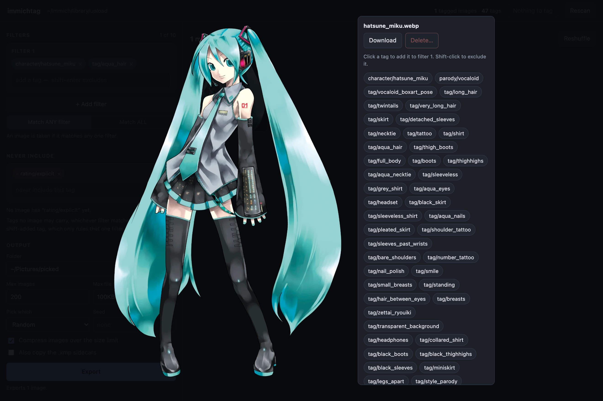
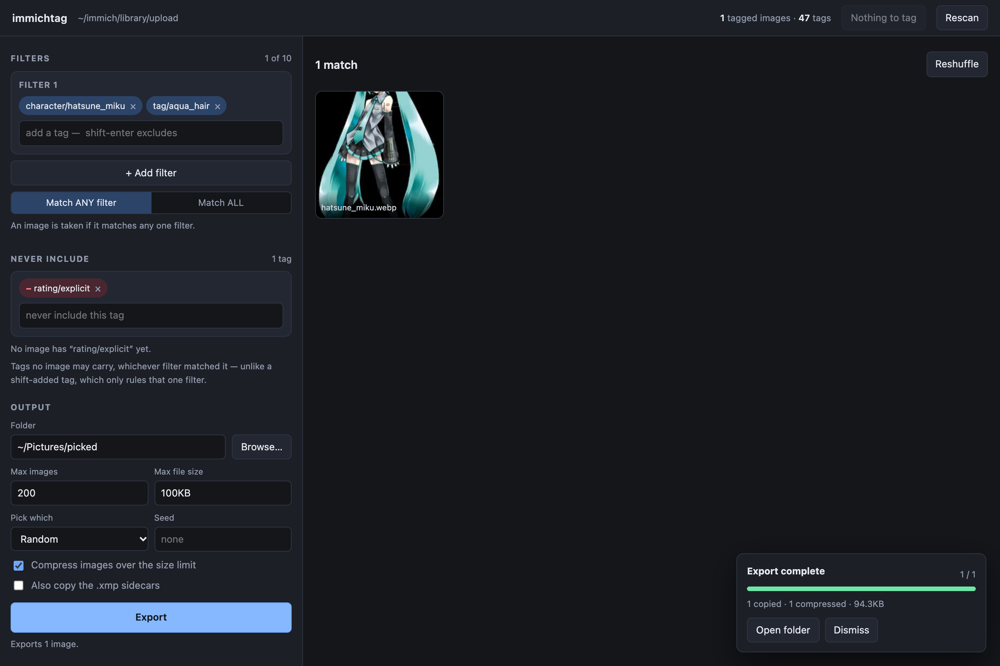

# immichtag

**English** · [简体中文](README.zh-CN.md)

Tag an anime image library with [PixAI Tagger v1.0], see the tags in [Immich], and pick
images by tag in a local web UI.

immichtag writes an XMP sidecar next to every image (`image.jpg` → `image.jpg.xmp`). Immich
reads those natively, so characters, series and ~40 descriptive tags per image show up as
Immich tags you can search and browse. The same sidecars drive a browser UI and a CLI for
filtering, exporting, downloading and trashing images.



[PixAI Tagger v1.0]: https://huggingface.co/pixai-labs/pixai-tagger-v1.0
[Immich]: https://immich.app

## Features

- **PixAI Tagger v1.0 by default.** A Danbooru-vocabulary tagger that recognises far more
  characters than WD14 and also predicts the series (copyright) and a rating. It runs on an
  Apple GPU or an NVIDIA GPU in half precision, or on the CPU.
- **Immich-native output.** Hierarchical tags (`character/…`, `parody/…`, `tag/…`, `meta/…`,
  `rating/…`) in the three XMP properties Immich reads. No database access, no plugin.
- **Keeps Immich in step.** After a run it asks Immich to re-read exactly the sidecars that
  changed, then deletes the tags nothing uses any more, but only under its own prefixes.
- **Web UI** (`immichtag-web`): tag autocomplete with counts, live thumbnails, full tag list
  per image, export to a folder with size limits, zip download, move to Immich's trash, and
  a Tag button that runs the tagger with a progress bar.
- **CLI export** (`immichtag-filter`): the same filters from the terminal.
- **Safe to run on a big library.** Incremental (finished images are skipped), atomic
  writes, interruptible, one run at a time, and every overwritten sidecar is backed up first.

## Requirements

- Python 3.11–3.13 and [uv](https://docs.astral.sh/uv/).
- macOS on Apple Silicon, or Linux. An NVIDIA GPU is used automatically when present. Windows
  is not supported.
- About 1.8 GB of disk for the model, downloaded from Hugging Face on the first run.
- Immich is optional. Without it, the tagger, the filter and the web UI still work on the
  sidecars; syncing and deleting need an Immich API key.

## Install

```bash
git clone https://github.com/e0kt/immichtag.git
cd immichtag
uv sync
```

Then run each command with `uv run immichtag…` from the repository. To install the commands on
your `PATH` instead: `uv tool install git+https://github.com/e0kt/immichtag`.

## Quick start

1. **Tell it which folder to tag.** Copy the example config and edit `[library] dir`:

   ```bash
   mkdir -p ~/.config/immichtag
   cp examples/config.toml ~/.config/immichtag/config.toml
   chmod 600 ~/.config/immichtag/config.toml
   ```

   `--dir /path` on any command, or `IMMICHTAG_DIR=/path`, overrides it. See
   [Immich setup](#immich-setup) for which folder that is.

2. **Look before you tag:**

   ```bash
   uv run immichtag --dry-run       # counts and a time estimate; doesn't load the model
   uv run immichtag --limit 20      # a quick trial run
   ```

3. **Tag everything:** `uv run immichtag`. This is also the everyday command. It tags every
   image without a sidecar (those come first) and re-tags every image whose sidecar another
   tagger or model version wrote, then syncs Immich. Interrupt it whenever you like and run it
   again later.

4. **Browse:** `uv run immichtag-web` opens the web UI at http://127.0.0.1:8788.

## Immich setup

immichtag works on the image files on disk, so it must run on a machine that sees Immich's
files: usually the Immich host itself. There are two ways to give it a folder. Both are spelled
out in [`examples/`](examples/).

### A. Immich's own uploads

No change to Immich is needed. Point `[library] dir` at the host folder that Immich's
`docker-compose.yml` mounts as `/data`, i.e. `UPLOAD_LOCATION` from Immich's `.env`, as an
absolute path:

```toml
[library]
dir = "/srv/immich/library"            # = UPLOAD_LOCATION

[immich]
url = "http://127.0.0.1:2283"
api_key = "…"
path_map = "/data=/srv/immich/library" # Immich's path = this machine's path (optional)
```

Immich's `thumbs/`, `encoded-video/`, `profile/` and `backups/` folders are skipped, so only
originals are tagged, whether or not the storage template is on. Immich already writes its own
sidecars into this folder, so writing more there is normal.

### B. An existing folder as an External Library

If your images already live in their own folder, mount it into Immich with
[`examples/immich/docker-compose.override.yml`](examples/immich/docker-compose.override.yml),
which Docker Compose merges automatically:

```yaml
services:
  immich-server:
    volumes:
      - /home/you/Pictures/anime:/mnt/anime
```

Then, in Immich, go to **Administration → External Libraries → Create library**, add the import
path `/mnt/anime` and scan. Configure immichtag with the host path:

```toml
[library]
dir = "/home/you/Pictures/anime"

[immich]
path_map = "/mnt/anime=/home/you/Pictures/anime"
```

Mount it read-write if you ever edit tags in Immich: Immich writes those edits back into the
sidecar, and immichtag keeps them when it re-tags. With a read-only mount, that write-back
fails, and the next sync (which makes Immich re-read the sidecar) drops the edits.

One configuration covers one folder. To tag both an upload folder and an external library, run
the second one with its own `IMMICHTAG_DIR` and `IMMICHTAG_PATH_MAP`.

`path_map` is optional in both setups. When it's left out, immichtag works it out by finding
Immich's asset paths under your folder. Set it when that fails, and the sync says so.

### API key

In Immich, go to **Account Settings → API Keys** on an **admin** account and create a key with:

`asset.read`, `asset.update`, `job.create`, `job.read`, `tag.read`, `tag.delete`

plus `asset.delete` if you want to move images to Immich's trash from the web UI. Put it in
`config.toml` (or `IMMICHTAG_API_KEY`). immichtag warns if the file is readable by other users.
`uv run immichtag-sync status` checks the connection and every permission.

### What a sync does

1. It asks Immich to re-read the sidecars written since the last sync, and to discover the
   sidecars of images Immich hasn't seen one for. Immich then replaces each image's tags with
   the sidecar's.
2. It waits for Immich's job queues to drain.
3. It deletes tags that no image uses any more, such as a tag the model stopped predicting
   after a re-tag. It only ever considers tags under `character`, `parody`, `tag`, `meta` and
   `rating`, never deletes a parent while anything below it is in use, and re-checks each tag
   right before deleting it. (Immich's own tag cleanup job is never used: it deletes **every**
   empty tag, yours included.)

If Immich is down or no key is set, tagging still finishes, and the images are remembered as
pending:

```bash
uv run immichtag-sync status              # connection, permissions, pending images
uv run immichtag-sync sync                # send the pending images
uv run immichtag-sync sync --all          # every image
uv run immichtag-sync cleanup --dry-run   # which empty tags would be deleted
uv run immichtag-sync cleanup
```

## Web UI

```bash
uv run immichtag-web
```

The whole library is indexed into memory at startup, so a filter is answered in about a
millisecond, even across ~90k images.

- **Filters.** Each filter is a set of tags that must all be present. An image matching any
  filter is taken; switch to **Match ALL** to require every filter. Shift-Enter adds a tag as
  an exclusion for that filter. Globs work: `blue_*`, `character/*`.
- **Autocomplete with counts**, so you know how big a selection is before you make it.
- **Never include**: tags no result may carry, whichever filter matched it.
- **Warnings** under a filter for tags that don't exist, or that only old sidecars still carry,
  with click-to-replace suggestions.
- **Click a thumbnail** for the full image and every tag. Clicking a tag adds it to the filter
  (shift-click excludes it).



- **Tag** (header) shows how many images are waiting and runs the same tagging as `immichtag`,
  with progress, time left and cancel. Reloading the page reattaches to a running job. A run
  from the terminal and one from the page can never overlap.
- **Sync to Immich** and **Clean up Immich tags** appear when there is something to do. The
  cleanup shows exactly which tags it would delete before you confirm.
- **Rescan** re-reads the sidecars after you tag from the terminal.

The server binds to `127.0.0.1` and has no authentication. The page can delete images, so don't
expose it with `--host`.

| Flag | Default | Purpose |
| --- | --- | --- |
| `--dir` | the configured library | Folder to index |
| `--port` | `8788` | At the default, moves to the next free port if taken. Given explicitly, fails instead |
| `--host` | `127.0.0.1` | Interface to bind |
| `--no-browser` | off | Don't open a browser window |

### Export preview

The **Output** panel copies the current matches to a folder. **Max images** together with
**Pick which** (scan order, random with an optional seed, newest, oldest) decides which matches
are kept. Anything over **Max file size** is re-encoded on the way. The hint under **Export**
says how many images will be written before you start, and the job panel reports what was copied
and compressed, and anything that stayed over the limit.



In this example, the 150 KB WebP original was over the 100 KB limit, so it was written as a
94 KB JPEG. An image already under the limit is copied byte for byte. Tick **Also copy the .xmp
sidecars** to take the tags along.

### Download and delete

- **↓** on a thumbnail, or **Download** in the viewer, saves that original file, untouched.
- **Tick thumbnails** to select them. Shift-click selects a range, and **Select all N matching**
  takes every match, including the ones not loaded yet. **Download** then streams one zip.
- **Delete…** moves the selection to **Immich's trash**, where it stays recoverable until Immich
  empties the trash (after 30 days by default). immichtag never deletes files itself. Above 100
  images you have to type the number to confirm. If Immich's trash is turned off, the dialog
  says the delete is permanent and always asks for the number.
- Every delete is logged in `deletions.jsonl` in the library's state folder (see
  [Where things are kept](#where-things-are-kept)).

## The tags

```xml
<digiKam:TagsList><rdf:Seq>
  <rdf:li>character/hatsune_miku</rdf:li>
  <rdf:li>parody/vocaloid</rdf:li>
  <rdf:li>tag/twintails</rdf:li>
  <rdf:li>tag/aqua_hair</rdf:li>
  …
  <rdf:li>meta/official_art</rdf:li>
  <rdf:li>rating/general</rdf:li>
</rdf:Seq></digiKam:TagsList>
```

The same list is written to `digiKam:TagsList`, `lr:HierarchicalSubject` and `dc:subject`,
together with a record of the model and revision that wrote it.

| Prefix | What | Example |
| --- | --- | --- |
| `character/` | Named characters | `character/hatsune_miku` |
| `parody/` | Series, game, franchise (the model's *copyright* category) | `parody/blue_archive`, `parody/original` |
| `tag/` | Everything visible | `tag/twintails`. Filler like `1girl`/`solo` is dropped unless `--keep-common-tags` |
| `meta/` | A short whitelist only | AI-generated, official art, screenshots, photos, traditional media |
| `rating/` | Exactly one per image | `general`, `sensitive`, `questionable`, `explicit` |

- **Artist/style tags are not written.** The model guesses them from drawing style, not from
  who actually drew the image.
- **A `/` inside a name becomes `∕`** (U+2215), because Immich splits tags on `/`. For example,
  `fate/grand_order` is stored as `parody/fate∕grand_order`. Filters accept either form.
- **Your own tags are kept.** Any tag outside the five prefixes above survives re-tagging,
  including tags you add in Immich, which Immich writes into the sidecar.

> [!WARNING]
> Re-tagging rewrites the whole sidecar. Tags are merged as described above, but other XMP
> fields in an existing sidecar that immichtag didn't write (a description, star rating, GPS
> or dates written by Immich or another app) are not carried over. The original is backed up
> first (see [Backups](#backups)). Try `--limit` on a copy if your sidecars hold more than tags.

## The model

PixAI Tagger v1.0 is the default and only model. It is loaded from Hugging Face, pinned to one
revision, and that revision is written into every sidecar. When the pinned revision changes, the
next run knows which images to re-tag.

| Device | Precision | Speed (decode + inference) |
| --- | --- | --- |
| Apple GPU (`mps`) | fp16 | ~1.8 images/s on an M5. About 14 h for 90k images |
| NVIDIA GPU (`cuda`) | fp16 | Not benchmarked yet. Should be faster than `mps` |
| CPU | fp32 | ~0.2 images/s. Usable for small libraries only |

`--device auto` (the default) picks `cuda`, then `mps`, then `cpu`, and warns when it falls back
to the CPU. A long run can be spread over several sessions: finished images are skipped.

Compared with WD14 (`wd-v1-4-convnextv2-tagger-v2`), in a 20-image sample PixAI named the
character in 16 images where WD14 named 6, and it fills `parody/`, which WD14 has no category
for. It uses a newer Danbooru vocabulary, so a few old tags are gone (e.g. `bangs` → `blunt_bangs`,
`swept_bangs`, …). The filter and the web UI point these out and suggest replacements.

### `immichtag` options

| Flag | Default | Purpose |
| --- | --- | --- |
| `--dir` | the configured library | Folder to tag |
| `--dry-run` | off | Counts and a time estimate, then exit |
| `--limit N` | none | Stop after N images |
| `--overwrite` | off | Also re-tag images already tagged by the current model |
| `--keep-common-tags` | off | Keep `1girl`, `solo`, `looking_at_viewer`, … |
| `--no-rating` | off | Don't write `rating/*` |
| `--general-threshold` | 0.34 | `tag/*` |
| `--character-threshold` | 0.37 | `character/*` |
| `--parody-threshold` | 0.46 | `parody/*` |
| `--meta-threshold` | 0.47 | `meta/*` (whitelisted tags only) |
| `--device` | `auto` | `cuda`, `mps`, `cpu` or `auto` |
| `--no-immich` | off | Don't sync afterwards. The images stay pending for `immichtag-sync sync` |

The thresholds are the model authors' per-category operating points, giving about 35–40 `tag/*`
tags per image.

## Filtering from the terminal: `immichtag-filter`

Reads the sidecars, picks images by tag, and copies them into a folder, shrinking anything over
1 MB on the way.

```bash
uv run immichtag-filter -f "character/hatsune_miku" -f "blue_hair,long_hair" \
    -x "rating/explicit" --max-images 200 --order random -o ./picked
```

- `--filter`/`-f` is a comma-separated group of tags that must **all** be present. Repeat it
  for up to 10 groups. An image matching **any** group is taken (`--match all` requires every
  group).
- Inside a group, `-tag` or `!tag` excludes that tag from that group only. `*` and `?` are
  globs. A bare name matches under any prefix (`blue_hair` finds `tag/blue_hair`). Case, spaces
  and dashes are folded.
- `--exclude`/`-x` vetoes tags across all groups. `-x "rating/explicit"` alone means
  "everything but those".
- Since a leading `-` looks like an option, write an exclusion-only filter as
  `-f '!rating/explicit'`.

| Flag | Default | Purpose |
| --- | --- | --- |
| `--filter` / `-f` | none | Tag group. Repeat up to 10 times. None = every tagged image |
| `--exclude` / `-x` | none | Tags no image may carry. Repeatable |
| `--match` | `any` | Combine groups with OR (`any`) or AND (`all`) |
| `--out` / `-o` | — | Output folder, created if missing |
| `--max-images` / `-n` | no limit | Stop after N images |
| `--max-size` | `1MB` | Compress anything larger. Accepts `900k`, `1.5MiB`, bytes |
| `--no-compress` | off | Copy every image untouched |
| `--order` | `scan` | Which matches `--max-images` keeps: `scan`, `random`, `newest`, `oldest` |
| `--seed` | none | Reproducible `--order random` |
| `--copy-sidecar` | off | Also copy each `.xmp` |
| `--list-tags [N]` | off | Print the N most common tags among the matches, then exit |
| `--dry-run` | off | Report how many images match, then exit |

**Compression:** an image under the limit is copied byte for byte. A larger one is re-encoded as
JPEG: quality first steps down from 92 toward 50, and only then is the image scaled down (never
below 640 px on the long side). Transparency is flattened onto white. Output names are flattened
into one folder (`img.jpg`, `img-1.jpg`, …).

## Backups

Before a run overwrites any sidecar, the originals go into a backup. A file already in an
earlier backup isn't stored twice. 90k sidecars take about 20 MB.

```bash
uv run immichtag-backup list
uv run immichtag-backup restore 20260922T031415Z   # puts those sidecars back, byte for byte
```

A restore first backs up the sidecars it replaces, then syncs Immich.

## Where things are kept

| What | Where |
| --- | --- |
| Config | `~/.config/immichtag/config.toml` (or `IMMICHTAG_CONFIG`) |
| State per library (lock, pending sync, backups, delete log) | macOS: `~/Library/Application Support/immichtag/<library id>/`. Linux: `$XDG_STATE_HOME/immichtag/<library id>/` (default `~/.local/state/…`). Or `IMMICHTAG_STATE_DIR` |
| Model | the Hugging Face cache (`~/.cache/huggingface`, or `HF_HOME`) |

Nothing but `.xmp` sidecars is ever written inside the library.

## Development

```bash
uv run pytest                              # unit tests; model tests run when the model is cached
uv run python scripts/bench20.py           # 20-image speed and quality check (read-only)
uv run python scripts/verify_immich.py     # Immich tags == sidecar tags, on a random sample
```

Each command is a core module plus a thin CLI entry point:

| Command | Core | Entry point |
| --- | --- | --- |
| `immichtag` | `run.py`, `tagger.py`, `sidecar.py`, `library.py` | `cli.py` |
| `immichtag-sync` | `immich.py` | `immich_cli.py` |
| `immichtag-backup` | `backup.py` | `backup_cli.py` |
| `immichtag-filter` | `filterer.py` | `filter_cli.py` |
| `immichtag-web` | `web.py`, `index.py`, `web/` | `web_cli.py` |

`vocab.py` holds the tag scheme (prefixes, thresholds, whitelist, escaping, matching) and
`config.py` resolves paths and settings. The web UI never reimplements filtering: it builds the
same `TagFilter` objects as the CLI, so the two can't drift apart. The design notes are in
[`specs/`](specs/).

## License

immichtag is released under the [MIT License](LICENSE).

The model is not part of this repository. PixAI Tagger v1.0's weights and model code are
downloaded from [Hugging Face][PixAI Tagger v1.0] at run time, and the model code runs with
`trust_remote_code`, pinned to a fixed revision. They are subject to PixAI's own terms, and that
repository declares no license.

The illustration in the screenshots is Hatsune Miku's official art, © Crypton Future Media, INC.
www.piapro.net, shown only to demonstrate the tagger's output.
