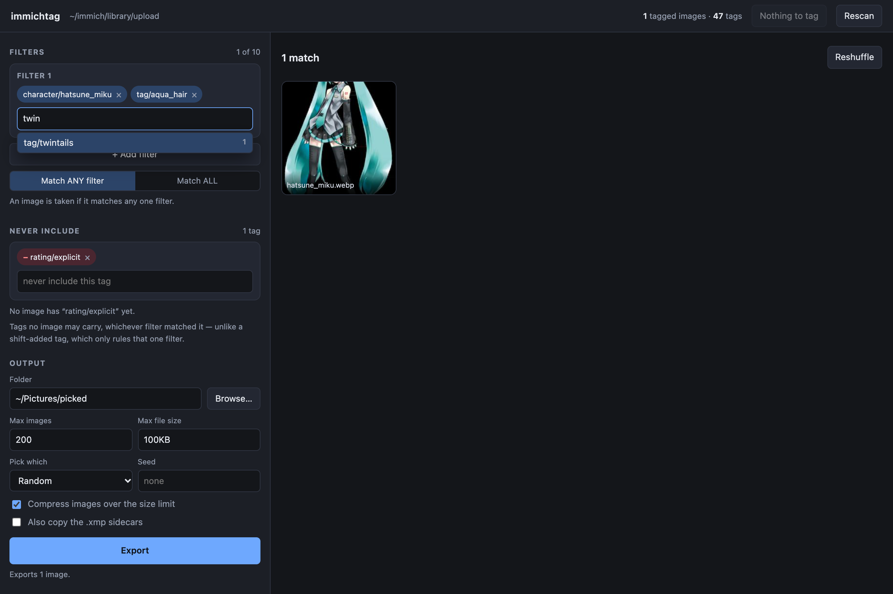
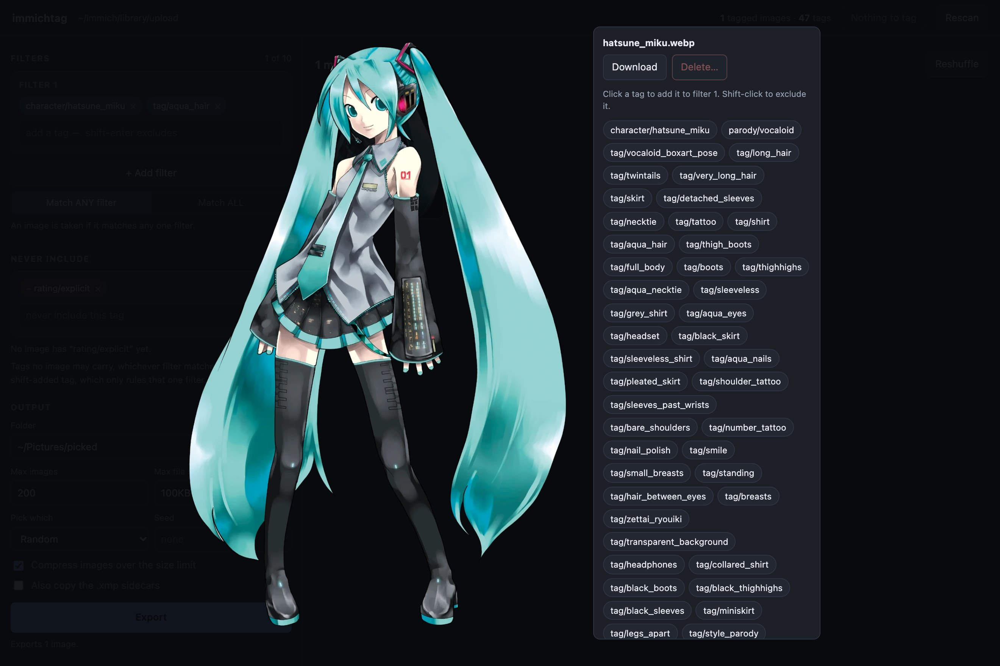
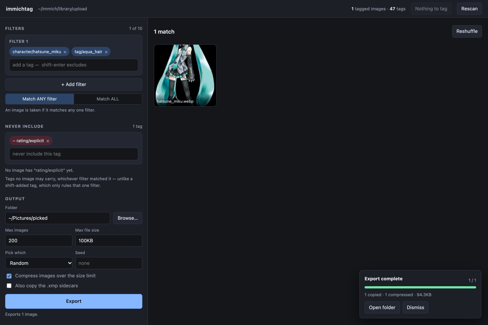

# immichtag

[English](README.md) · **简体中文**

用 [PixAI Tagger v1.0] 给二次元图库打标签，在 [Immich] 里直接看到这些标签，再在本地网页里按标签挑图。

immichtag 会在每张图旁边写一个 XMP sidecar 文件（`image.jpg` → `image.jpg.xmp`）。Immich 原生读取这种文件，所以角色、作品以及每张图约 40 个描述标签都会变成 Immich 里可搜索、可浏览的标签。同一批 sidecar 还驱动一个网页界面和一个命令行工具，用来筛选、导出、下载和删除图片。



[PixAI Tagger v1.0]: https://huggingface.co/pixai-labs/pixai-tagger-v1.0
[Immich]: https://immich.app

## 功能

- **默认使用 PixAI Tagger v1.0。** 基于 Danbooru 词表的打标模型，认出的角色比 WD14 多得多，还能预测作品（copyright）和分级。在 Apple GPU 或 NVIDIA GPU 上以半精度运行，也可以用 CPU。
- **Immich 原生格式。** 分层标签（`character/…`、`parody/…`、`tag/…`、`meta/…`、`rating/…`）写进 Immich 会读的三个 XMP 字段。不碰数据库，不需要插件。
- **与 Immich 保持同步。** 每次打标后只让 Immich 重读有变化的 sidecar，再删掉没有图片在用的标签，而且只删自己前缀下的。
- **网页界面**（`immichtag-web`）：带计数的标签自动补全、实时缩略图、每张图的完整标签、按大小限制导出到文件夹、打包 zip 下载、移入 Immich 回收站，以及一个带进度条的「Tag」按钮直接打标。
- **命令行导出**（`immichtag-filter`）：在终端里用同样的筛选规则。
- **大图库也放心跑。** 增量处理（已完成的会跳过）、原子写入、随时可中断、同一时间只跑一个任务，覆盖任何 sidecar 之前都会先备份。

## 环境要求

- Python 3.11–3.13 和 [uv](https://docs.astral.sh/uv/)。
- Apple Silicon 的 macOS，或 Linux。有 NVIDIA GPU 时会自动使用。不支持 Windows。
- 约 1.8 GB 磁盘空间放模型，首次运行时从 Hugging Face 下载。
- Immich 是可选的。没有它，打标、筛选和网页界面照样能用 sidecar 工作；同步和删除需要 Immich API key。

## 安装

```bash
git clone https://github.com/e0kt/immichtag.git
cd immichtag
uv sync
```

之后在仓库目录下用 `uv run immichtag…` 运行各个命令。也可以把命令装到 `PATH` 上：`uv tool install git+https://github.com/e0kt/immichtag`。

## 快速开始

1. **告诉它要给哪个文件夹打标。** 复制示例配置，改 `[library] dir`：

   ```bash
   mkdir -p ~/.config/immichtag
   cp examples/config.toml ~/.config/immichtag/config.toml
   chmod 600 ~/.config/immichtag/config.toml
   ```

   任何命令都可以用 `--dir /path` 或 `IMMICHTAG_DIR=/path` 覆盖它。具体该填哪个文件夹，见 [Immich 配置](#immich-配置)。

2. **先看看再打标：**

   ```bash
   uv run immichtag --dry-run       # 统计数量并估算时间，不加载模型
   uv run immichtag --limit 20      # 先试 20 张
   ```

3. **全部打标：** `uv run immichtag`。日常也只用这一条命令。它会给所有没有 sidecar 的图打标（这些优先），并重打所有由其他打标工具或其他模型版本写的 sidecar，最后同步 Immich。随时可以中断，下次接着跑。

4. **浏览：** `uv run immichtag-web` 会打开网页界面 http://127.0.0.1:8788。

## Immich 配置

immichtag 直接处理磁盘上的图片文件，所以它必须跑在能看到 Immich 文件的机器上，通常就是 Immich 所在的主机。有两种方式指定文件夹，[`examples/`](examples/) 里都有完整示例。

### A. Immich 自己的上传目录

不需要改 Immich。把 `[library] dir` 指向 Immich 的 `docker-compose.yml` 挂载为 `/data` 的那个主机目录，也就是 Immich `.env` 里的 `UPLOAD_LOCATION`，写绝对路径：

```toml
[library]
dir = "/srv/immich/library"            # = UPLOAD_LOCATION

[immich]
url = "http://127.0.0.1:2283"
api_key = "…"
path_map = "/data=/srv/immich/library" # Immich 看到的路径 = 本机路径（可选）
```

Immich 的 `thumbs/`、`encoded-video/`、`profile/`、`backups/` 会被跳过，所以无论是否开启存储模板，都只给原图打标。Immich 本来就会往这个目录写自己的 sidecar，再多写一些是正常的。

### B. 已有的图片文件夹作为外部图库

如果图片已经放在单独的文件夹里，用 [`examples/immich/docker-compose.override.yml`](examples/immich/docker-compose.override.yml) 把它挂进 Immich（Docker Compose 会自动合并这个文件）：

```yaml
services:
  immich-server:
    volumes:
      - /home/you/Pictures/anime:/mnt/anime
```

然后在 Immich 里进入**管理 → 外部图库 → 创建图库**，添加导入路径 `/mnt/anime` 并扫描。immichtag 这边填主机路径：

```toml
[library]
dir = "/home/you/Pictures/anime"

[immich]
path_map = "/mnt/anime=/home/you/Pictures/anime"
```

如果你会在 Immich 里改标签，就要以可读写方式挂载：Immich 会把这些修改写回 sidecar，immichtag 重新打标时会保留它们。只读挂载时这次写回会失败，下一次同步（让 Immich 重读 sidecar）就会把你的修改冲掉。

一份配置对应一个文件夹。要同时给上传目录和外部图库打标，第二个用单独的 `IMMICHTAG_DIR` 和 `IMMICHTAG_PATH_MAP` 来跑。

两种方式里 `path_map` 都是可选的。不填时，immichtag 会在你的文件夹里找 Immich 的资源路径，自动推出映射。推不出来时同步会提示你设置它。

### API key

在 Immich 的**管理员**账号下进入**账户设置 → API 密钥**，创建一个带以下权限的 key：

`asset.read`、`asset.update`、`job.create`、`job.read`、`tag.read`、`tag.delete`

如果想在网页里把图片移入 Immich 回收站，再加 `asset.delete`。把它写进 `config.toml`（或 `IMMICHTAG_API_KEY`）。配置文件能被其他用户读取时 immichtag 会警告。`uv run immichtag-sync status` 会检查连接和每一项权限。

### 同步时做了什么

1. 让 Immich 重读上次同步以来写过的 sidecar，并为还没发现 sidecar 的图片执行发现。Immich 随后用 sidecar 里的标签替换每张图的标签。
2. 等 Immich 的任务队列清空。
3. 删除不再有图片使用的标签，比如重新打标后模型不再预测的标签。只考虑 `character`、`parody`、`tag`、`meta`、`rating` 下的标签；子标签还在用时绝不删父标签；每个标签删除前会再确认一次是空的。（从不使用 Immich 自带的标签清理任务：它会删掉**所有**空标签，包括你自己的。）

如果 Immich 没启动或没设 key，打标照样完成，这些图会被记为待同步：

```bash
uv run immichtag-sync status              # 连接、权限、待同步数量
uv run immichtag-sync sync                # 同步待同步的图片
uv run immichtag-sync sync --all          # 同步所有图片
uv run immichtag-sync cleanup --dry-run   # 列出会被删除的空标签
uv run immichtag-sync cleanup
```

## 网页界面

```bash
uv run immichtag-web
```

启动时把整个图库索引进内存，之后即使有约 9 万张图，一次筛选也只要一毫秒左右。

- **筛选。** 每个筛选是一组必须同时存在的标签。匹配任意一个筛选的图都会入选；切到 **Match ALL** 则要求匹配全部筛选。Shift-Enter 把标签作为这个筛选的排除项。支持通配符：`blue_*`、`character/*`。
- **带计数的自动补全**，选之前就知道结果有多少张。
- **Never include（全局排除）**：无论匹配了哪个筛选，结果里都不能有这些标签。
- **筛选下方的警告**：标签不存在，或只有旧 sidecar 还带着时会提示，点建议即可替换。
- **点缩略图**看大图和全部标签。点标签加入筛选（Shift 点击则排除）。



- 顶栏的 **Tag** 显示有多少张图待打标，运行的和 `immichtag` 完全相同，带进度、剩余时间和取消。刷新页面会重新接上正在跑的任务。终端里的任务和网页里的任务永远不会同时运行。
- 有事可做时会出现 **Sync to Immich** 和 **Clean up Immich tags**。清理前会列出要删的每一个标签，确认后才删。
- 在终端里打标之后点 **Rescan** 重新读取 sidecar。

服务只监听 `127.0.0.1`，没有认证。页面能删除图片，所以不要用 `--host` 把它暴露出去。

| 参数 | 默认值 | 作用 |
| --- | --- | --- |
| `--dir` | 配置的图库 | 要索引的文件夹 |
| `--port` | `8788` | 用默认值时，端口被占会自动顺延；显式指定时则直接报错 |
| `--host` | `127.0.0.1` | 监听的网卡 |
| `--no-browser` | 关 | 不自动打开浏览器 |

### 导出预览

**Output** 面板把当前匹配结果复制到一个文件夹。**Max images** 和 **Pick which**（扫描顺序、随机（可设种子）、最新、最旧）决定保留哪些图。超过 **Max file size** 的图会在导出时重新编码。**Export** 下方会提前显示将写出多少张，任务面板报告复制了多少、压缩了多少，以及仍超出限制的数量。



这个例子里，150 KB 的 WebP 原图超过了 100 KB 的限制，于是被写成了 94 KB 的 JPEG。本来就在限制以内的图会逐字节原样复制。勾选 **Also copy the .xmp sidecars** 可以把标签一起带走。

### 下载和删除

- 缩略图上的 **↓**，或大图里的 **Download**，下载未经处理的原文件。
- **勾选缩略图**进行多选。Shift 点击选中一个范围，**Select all N matching** 选中全部匹配（包括还没加载出来的）。然后 **Download** 会流式打包成一个 zip。
- **Delete…** 把所选图片移入 **Immich 回收站**，在 Immich 清空回收站之前（默认 30 天）都能恢复。immichtag 自己从不删除文件。超过 100 张时需要输入数量确认。如果 Immich 关闭了回收站，对话框会说明删除是永久的，并且总是要求输入数量。
- 每次删除都记录在图库状态目录下的 `deletions.jsonl` 里（见[文件存放位置](#文件存放位置)）。

## 标签

```xml
<digiKam:TagsList><rdf:Seq>
  <rdf:li>character/hatsune_miku</rdf:li>
  <rdf:li>parody/vocaloid</rdf:li>
  <rdf:li>tag/twintails</rdf:li>
  <rdf:li>tag/aqua_hair</rdf:li>
  …
  <rdf:li>meta/official_art</rdf:li>
  <rdf:li>rating/general</rdf:li>
</rdf:Seq></digiKam:TagsList>
```

同样的列表会写进 `digiKam:TagsList`、`lr:HierarchicalSubject` 和 `dc:subject`，并附带写入它的模型和版本记录。

| 前缀 | 内容 | 例子 |
| --- | --- | --- |
| `character/` | 角色 | `character/hatsune_miku` |
| `parody/` | 作品、游戏、系列（模型的 *copyright* 类别） | `parody/blue_archive`、`parody/original` |
| `tag/` | 画面里能看到的一切 | `tag/twintails`。`1girl`/`solo` 这类常见标签默认丢弃，用 `--keep-common-tags` 保留 |
| `meta/` | 仅限一小组白名单 | AI 生成、官方图、截图、照片、传统媒介 |
| `rating/` | 每张图恰好一个 | `general`、`sensitive`、`questionable`、`explicit` |

- **不写画师/画风标签。** 模型是根据画风猜的，而不是真正的作者。
- **名字里的 `/` 会写成 `∕`**（U+2215），因为 Immich 用 `/` 分层。比如 `fate/grand_order` 存为 `parody/fate∕grand_order`。筛选时两种写法都可以。
- **你自己的标签会保留。** 上面五个前缀之外的标签在重新打标后都还在，包括你在 Immich 里加的（Immich 会把它们写进 sidecar）。

> [!WARNING]
> 重新打标会重写整个 sidecar。标签按上面的规则合并，但已有 sidecar 里不是 immichtag 写的其他 XMP 字段（Immich 或其他软件写入的描述、星级、GPS、日期）不会保留。原文件会先备份（见[备份](#备份)）。如果你的 sidecar 里不只有标签，请先在副本上用 `--limit` 试一下。

## 模型

PixAI Tagger v1.0 是默认且唯一的模型。它从 Hugging Face 加载并固定在一个版本上，这个版本号会写进每个 sidecar。固定版本更新后，下一次运行就知道哪些图需要重打。

| 设备 | 精度 | 速度（解码 + 推理） |
| --- | --- | --- |
| Apple GPU（`mps`） | fp16 | M5 上约 1.8 张/秒，9 万张约 14 小时 |
| NVIDIA GPU（`cuda`） | fp16 | 尚未实测，应比 `mps` 快 |
| CPU | fp32 | 约 0.2 张/秒，只适合小图库 |

`--device auto`（默认）依次选择 `cuda`、`mps`、`cpu`，退回 CPU 时会警告。长任务可以分多次跑完，已完成的图会被跳过。

和 WD14（`wd-v1-4-convnextv2-tagger-v2`）相比，在 20 张图的抽样里，PixAI 认出了 16 张的角色，WD14 只认出 6 张；而且 PixAI 能填 `parody/`，WD14 根本没有这个类别。它用的是更新的 Danbooru 词表，少数旧标签已经不存在（比如 `bangs` → `blunt_bangs`、`swept_bangs` 等）。筛选工具和网页界面会指出这些标签并给出替换建议。

### `immichtag` 参数

| 参数 | 默认值 | 作用 |
| --- | --- | --- |
| `--dir` | 配置的图库 | 要打标的文件夹 |
| `--dry-run` | 关 | 统计并估算时间后退出 |
| `--limit N` | 无 | 处理 N 张后停止 |
| `--overwrite` | 关 | 当前模型已打过的也重打 |
| `--keep-common-tags` | 关 | 保留 `1girl`、`solo`、`looking_at_viewer` 等 |
| `--no-rating` | 关 | 不写 `rating/*` |
| `--general-threshold` | 0.34 | `tag/*` |
| `--character-threshold` | 0.37 | `character/*` |
| `--parody-threshold` | 0.46 | `parody/*` |
| `--meta-threshold` | 0.47 | `meta/*`（仅白名单） |
| `--device` | `auto` | `cuda`、`mps`、`cpu` 或 `auto` |
| `--no-immich` | 关 | 打完不同步，留待 `immichtag-sync sync` |

这些阈值是模型作者给出的各类别推荐值，每张图大约产生 35–40 个 `tag/*` 标签。

## 终端筛选：`immichtag-filter`

读取 sidecar，按标签挑图并复制到一个文件夹，超过 1 MB 的会顺便压缩。

```bash
uv run immichtag-filter -f "character/hatsune_miku" -f "blue_hair,long_hair" \
    -x "rating/explicit" --max-images 200 --order random -o ./picked
```

- `--filter`/`-f` 是一组逗号分隔、必须**全部**存在的标签。最多可重复 10 组。匹配**任意**一组的图都会入选（`--match all` 要求每组都匹配）。
- 组内的 `-tag` 或 `!tag` 只在这一组里排除该标签。`*` 和 `?` 是通配符。不带前缀的名字匹配任意前缀（`blue_hair` 能找到 `tag/blue_hair`）。大小写、空格和连字符都会归一化。
- `--exclude`/`-x` 对所有组生效。单独用 `-x "rating/explicit"` 表示「除这些以外的全部」。
- 开头的 `-` 会被当成命令行选项，所以只有排除项的筛选要写成 `-f '!rating/explicit'`。

| 参数 | 默认值 | 作用 |
| --- | --- | --- |
| `--filter` / `-f` | 无 | 标签组，最多重复 10 次。不填 = 所有已打标的图 |
| `--exclude` / `-x` | 无 | 任何图都不能带的标签，可重复 |
| `--match` | `any` | 组之间用 OR（`any`）还是 AND（`all`） |
| `--out` / `-o` | — | 输出文件夹，不存在会创建 |
| `--max-images` / `-n` | 不限 | 最多 N 张 |
| `--max-size` | `1MB` | 超过就压缩，可写 `900k`、`1.5MiB` 或字节数 |
| `--no-compress` | 关 | 全部原样复制 |
| `--order` | `scan` | `--max-images` 保留哪些：`scan`、`random`、`newest`、`oldest` |
| `--seed` | 无 | 让 `--order random` 可复现 |
| `--copy-sidecar` | 关 | 同时复制 `.xmp` |
| `--list-tags [N]` | 关 | 打印匹配结果里最常见的 N 个标签后退出 |
| `--dry-run` | 关 | 只报告匹配数量后退出 |

**压缩方式：** 限制以内的图逐字节复制。超出的重新编码为 JPEG：先把质量从 92 逐步降到 50，仍然超出才缩小尺寸（长边不低于 640 px）。透明背景会铺成白色。输出文件名全部平铺到一个文件夹里（`img.jpg`、`img-1.jpg`……）。

## 备份

运行时覆盖任何 sidecar 之前，原文件都会先进备份。已经在之前备份里的文件不会重复保存。9 万个 sidecar 大约占 20 MB。

```bash
uv run immichtag-backup list
uv run immichtag-backup restore 20260922T031415Z   # 逐字节还原这批 sidecar
```

还原前会先备份即将被替换的 sidecar，还原后会同步 Immich。

## 文件存放位置

| 内容 | 位置 |
| --- | --- |
| 配置 | `~/.config/immichtag/config.toml`（或 `IMMICHTAG_CONFIG`） |
| 每个图库的状态（锁、待同步、备份、删除日志） | macOS：`~/Library/Application Support/immichtag/<library id>/`。Linux：`$XDG_STATE_HOME/immichtag/<library id>/`（默认 `~/.local/state/…`）。或 `IMMICHTAG_STATE_DIR` |
| 模型 | Hugging Face 缓存（`~/.cache/huggingface`，或 `HF_HOME`） |

图库里除了 `.xmp` sidecar 以外什么都不写。

## 开发

```bash
uv run pytest                              # 单元测试；模型已缓存时也会跑模型测试
uv run python scripts/bench20.py           # 20 张图的速度和质量检查（只读）
uv run python scripts/verify_immich.py     # 随机抽样核对 Immich 标签 == sidecar 标签
```

每个命令都是一个核心模块加一个很薄的命令行入口：

| 命令 | 核心 | 入口 |
| --- | --- | --- |
| `immichtag` | `run.py`、`tagger.py`、`sidecar.py`、`library.py` | `cli.py` |
| `immichtag-sync` | `immich.py` | `immich_cli.py` |
| `immichtag-backup` | `backup.py` | `backup_cli.py` |
| `immichtag-filter` | `filterer.py` | `filter_cli.py` |
| `immichtag-web` | `web.py`、`index.py`、`web/` | `web_cli.py` |

`vocab.py` 定义标签体系（前缀、阈值、白名单、转义、匹配规则），`config.py` 负责路径和设置。网页界面不重新实现筛选，它构造和命令行相同的 `TagFilter` 对象，所以两者不会出现分歧。设计文档在 [`specs/`](specs/)。

## 许可证

immichtag 以 [MIT 许可证](LICENSE)发布。

模型不包含在本仓库中。PixAI Tagger v1.0 的权重和模型代码在运行时从 [Hugging Face][PixAI Tagger v1.0] 下载，模型代码以 `trust_remote_code` 方式运行并固定在某个版本。它们受 PixAI 自己的条款约束，该仓库没有声明许可证。

截图中的插画是初音未来官方设定图，© Crypton Future Media, INC. www.piapro.net，仅用于展示打标效果。
